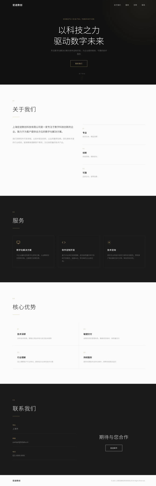

# 大模型前端生成能力对比测试

同一需求，在 OpenCode 中对比不同大模型的网页生成效果。

## 测试 Prompt

> 帮我在这个文件夹里新建一个项目，名称 htlabs-test，然后主要做一个上海宏途数创科技有限公司的企业站，简洁高尚为主即可。

| | GPT-5.5 | Mimo v2.5 Pro |
|---|---|---|
| 模型 ID | `nexahub/gpt-5.5` | `xiaomi-mimo/mimo-v2.5-pro` |
| 策略 | 三套风格并行 | 单套精品直出 |
| Skills 调用 | 4 个 (brainstorming → writing-plans → frontend-design → TDD) | 1 个 (brainstorming) |
| 产出 | 4 HTML + 测试脚本 + 设计文档 | HTML + CSS + JS 三件套 |

---

## 效果对比

| GPT-5.5 | Mimo v2.5 Pro |
|:---:|:---:|
|  |  |
| 深色科技风（三套之一） | 简约高端风（唯一一套） |

<details>
<summary>GPT-5.5 其他两套风格</summary>

| 浅色极简商务风 | 东方留白高端风 |
|:---:|:---:|
|  |  |

</details>

---

## Skills 调用对比

**GPT-5.5** 调用了 4 个 Skill，走完整工程流程：

| Skill | 用途 |
|---|---|
| `brainstorming` | 需求探索与方向确认 |
| `writing-plans` | 生成设计文档与实施计划 |
| `frontend-design` | 页面视觉设计与实现 |
| `test-driven-development` | 先写检查脚本再生成页面 |

**Mimo v2.5 Pro** 仅调用 1 个 Skill：

| Skill | 用途 |
|---|---|
| `brainstorming` | 需求探索与方向确认 |

确认方案后跳过其他 Skill 直接写代码，视觉质量完全靠模型自身设计能力。

---

## 文件结构

```
gpt-5.5/
├── index.html                    — 三套风格入口选择页
├── dark.html                     — 深色高级科技风
├── light.html                    — 浅色极简商务风
├── oriental.html                 — 东方留白高端风
├── tests/check-static-site.js    — TDD 静态文件检查脚本
└── docs/plans/                   — 设计方案 + 实施计划

mimo-v2.5pro/
├── index.html                    — 页面结构
├── style.css                     — 样式
└── script.js                     — 交互
```

---

## 效果分析

| 维度 | GPT-5.5 | Mimo v2.5 Pro |
|---|---|---|
| **视觉风格** | 三套风格，但都偏素，缺乏高级感 | 单套精品，金色点缀有质感 |
| **交互** | 仅基础悬浮效果 | 滚动渐入、视差、导航变色、交错动画 |
| **移动端** | 隐藏导航，无汉堡菜单 | 完整汉堡菜单 + 响应式适配 |
| **字体** | 系统字体 | Google Fonts (Inter + Noto Sans SC) |
| **动画** | 无 | fadeUp / scrollPulse / 交错渐入 |

---

## 实际评价

**GPT-5.5：** 不适合直接生成页面。审美丑而不自知，喜欢说教。流程倒是走得规矩（TDD、设计文档一套一套的），但页面本身视觉质量拉胯，三套风格看着多，没一套能打的。

**Mimo v2.5 Pro：** 生成页面效果真不赖。虽然平时非页面相关工作提示词要说得细一些，但前端审美在线——金色点缀、留白节奏、滚动动画都到位，3 轮对话出活，不废话。

---

## 预览

```bash
open gpt-5.5/index.html      # GPT-5.5 入口页
open mimo-v2.5pro/index.html  # Mimo
```
